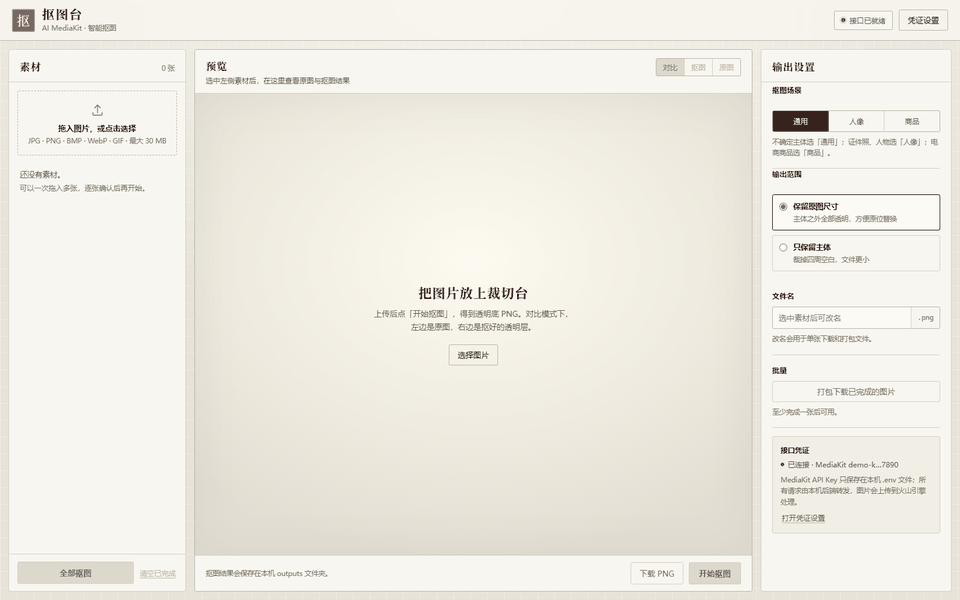
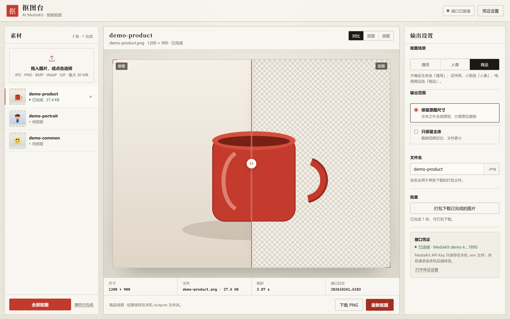
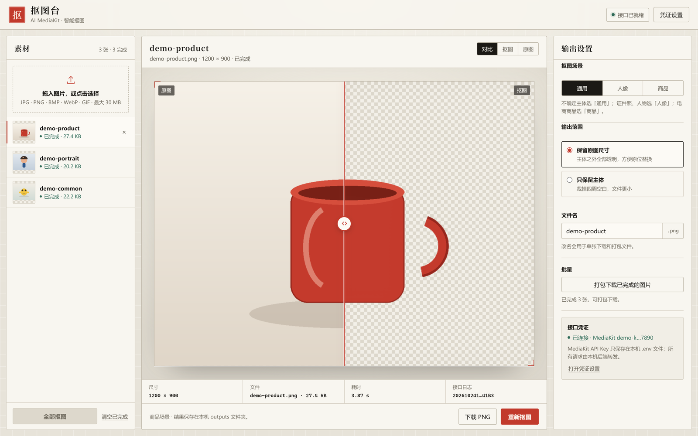
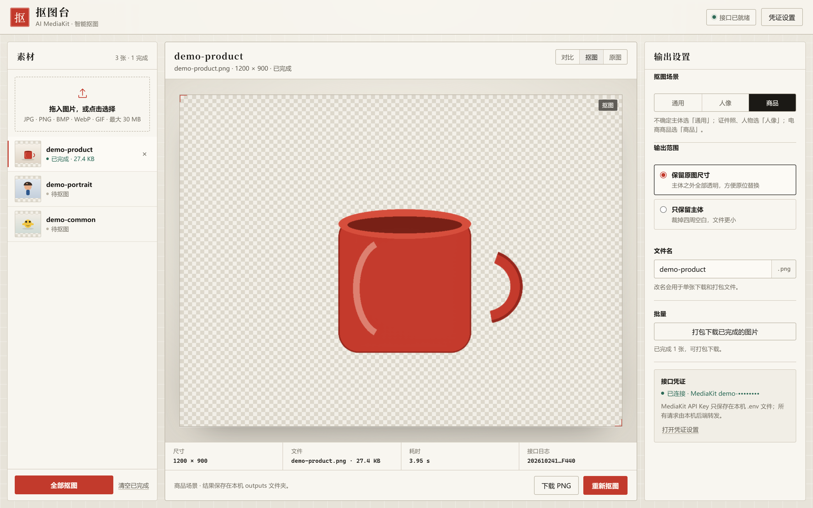
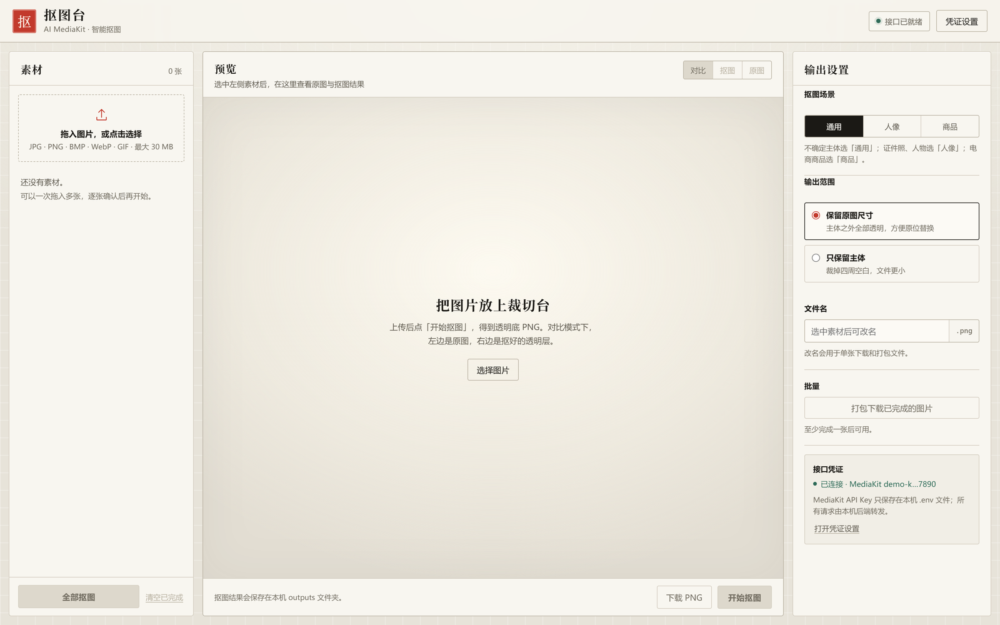
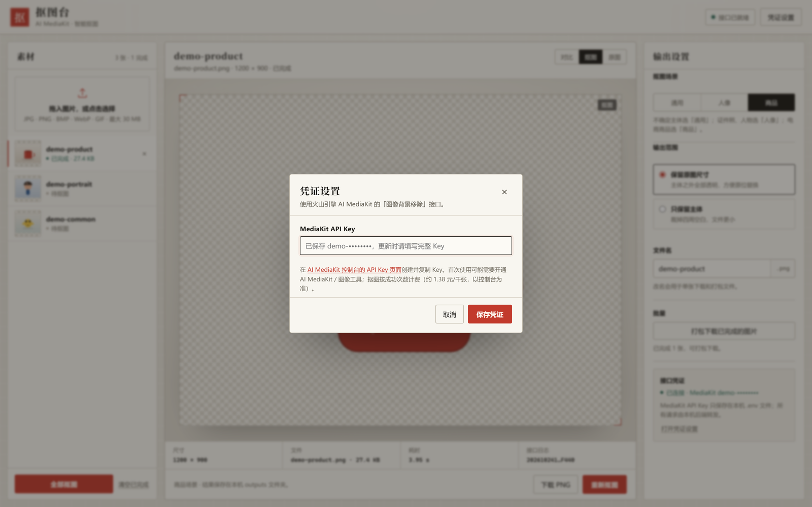
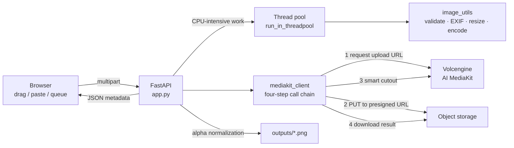
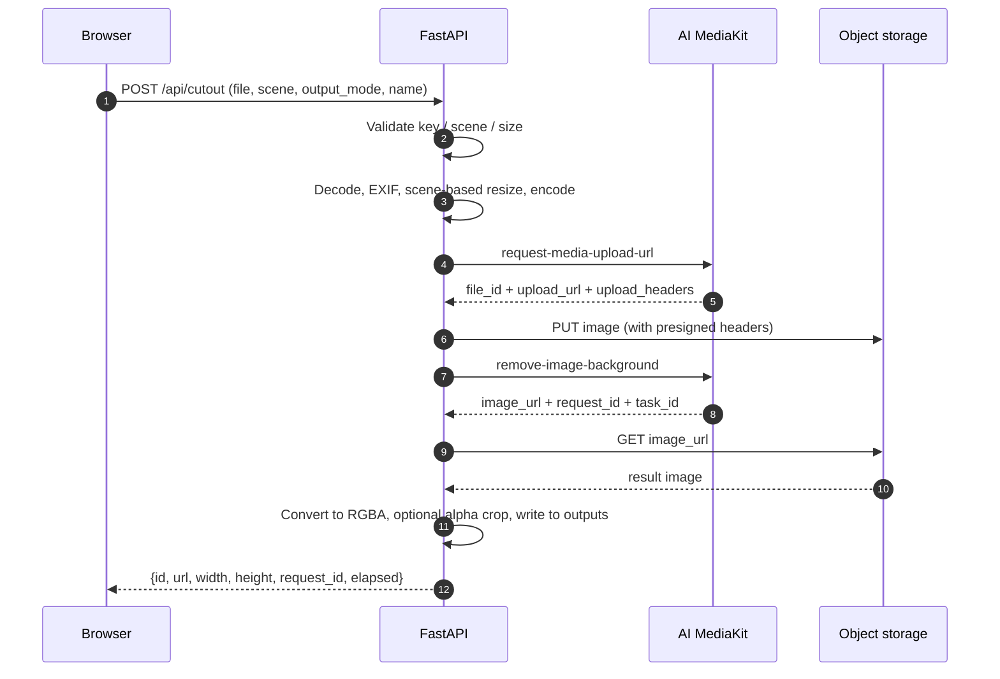

<div align="center">

<h1>✂️ Cutout Studio · Background Removal Workbench</h1>
<h3>A local-first AI background-removal workbench: batch-ready, controllable and traceable.</h3>
<p><strong>A local-first AI background-removal workbench powered by Volcengine AI MediaKit.</strong></p>
<p>Drag in an image and get a true alpha-channel transparent PNG; credentials and results stay on your machine, while images are sent to Volcengine AI MediaKit for processing.</p>

<p>


</p>

<p><a href="README.md">English</a> | <a href="README.zh-CN.md">简体中文</a></p>

<p><strong><a href="docs/images/demo.gif">▶ Watch the demo GIF</a></strong></p>


</div>

<p align="center">
  
</p>

<p align="center"><sub>Animated demo: import a synthetic asset → start the cutout → drag the comparison slider → view the transparent PNG result.</sub></p>

---

**[Project Overview](#-project-overview)** · **[Features](#-feature-overview)** · **[Architecture](#-system-architecture)** · **[Engineering Challenges](#-engineering-challenges-and-solutions)** · **[Security Model](#-security-and-privacy-model)** · **[Quick Start](#-quick-start)** · **[Tests & CI](#-tests-and-continuous-integration)** · **[Engineering Design](docs/ENGINEERING.md)** · **[Changelog](CHANGELOG.md)** · **[Security Policy](SECURITY.md)**

> **English TL;DR** — Cutout Studio is a local-first web workbench for AI background removal, built with FastAPI and the Volcengine AI MediaKit `remove-image-background` API. It covers the full media pipeline: input validation and normalization, presigned uploads, synchronous segmentation, alpha-PNG post-processing, a serial batch queue, a comparison slider and resolution-grouped ZIP export. Images are uploaded to Volcengine AI MediaKit for processing; the API key never reaches the browser, the server binds to `127.0.0.1`, rejects cross-origin writes and sanitizes every user-controlled filename. 58 pytest tests cover the HTTP API, image pipeline, upstream error mapping and the frontend/HTML contract. MIT licensed.

## ✨ Project Overview

"AI Cutout" in the Doubao app is a consumer feature and has no separate public developer API. The publicly callable background-removal capability lives in **Volcengine AI MediaKit** — this project uses its "image background removal (smart cutout)" API and wraps a single cloud call into a complete local workbench:

**Drag in an image → local validation and normalization → presigned upload → synchronous cutout → alpha-PNG post-processing → preview / batch / packaged download**.

What it addresses is not "can the background be removed at all" but "can it be trusted for batch processing":

- **True transparency, not an approximation**: results keep the alpha channel and support two output scopes: "keep original size" and "subject only".
- **Local-first**: the service listens only on `127.0.0.1`; the API Key is written only to the local `.env` (or supplied through process environment variables), and the browser never receives the full key; images are sent to Volcengine AI MediaKit for processing.
- **Built for real batches**: a queue of up to 50 images, one-by-one serial processing, per-image retry, `↑` / `↓` to switch assets in order, and resolution-grouped packaging when finished.
- **Explainable failures**: upstream errors such as authentication failure, service not activated, insufficient balance, rate limiting and size limits are mapped to clear Chinese-language messages, with `request_id` / `task_id` preserved for troubleshooting.
- **Zero-build frontend**: vanilla HTML/CSS/JS with no npm, no framework and no CDN dependencies; start it and use it.
- **Verifiable engineering**: pytest + a GitHub Actions multi-version matrix + the MIT License.

### Why not the "Doubao API"?

This is a common misconception. Background removal in the Doubao app is an in-product feature; what developers can call is Volcengine's media processing capability. AI MediaKit's cutout API bills per successful processing run (the official pricing page currently lists about **CNY 1.38 per thousand calls**, i.e. about **CNY 0.00138 per image**; the console's billing record is authoritative). This project states this clearly in both the README and the UI, and never implies "free, unlimited background removal".

## 📸 UI Screenshots

> Screenshots are taken from the real UI running locally on Windows. The demo assets are **programmatically generated synthetic images** (`docs/images/demo-*.png`), and credential masks are fake demo values (`demo-k…7890`); they contain no personal photos or real keys.

<p align="center">
  
</p>

<p align="center"><sub>Drag the center line to compare the source image with the cutout result; the right panel switches scene, output scope and file name, and offers batch download.</sub></p>

| Batch queue: 3 completed | Transparent result: checkerboard preview |
| :---: | :---: |
|  |  |

<details>
<summary><b>Expand to view: empty state and credential settings</b></summary>

<br>

| Empty state | Credential settings (key masked) |
| :---: | :---: |
|  |  |

</details>

## 🚀 Feature Overview

| Feature | Capabilities | Engineering approach |
| --- | --- | --- |
| **Asset import** | Drag and drop, click to select, `Ctrl+V` paste; JPG / PNG / BMP / WebP / GIF; ≤ 30 MB per image; queue limit 50 | The frontend validates type, size and count first; the backend validates independently again and never trusts the client |
| **Pre-upload normalization** | EXIF orientation correction, first frame for GIFs, alpha-channel detection, scene-based scaling limits | Three constraints: long edge / short edge / total pixels; proportional LANCZOS scaling; iterative recompression down to ≤ 28 MB when needed |
| **Smart cutout** | Three scenes: general / portrait / product; keep the original size or subject only | Four-step call chain: request upload URL → presigned PUT → synchronous cutout → download result |
| **Result post-processing** | Uniform RGBA PNG; transparent borders cropped along the alpha boundary | For the general scene, "subject only" falls back to local `alpha.getbbox()`, independent of upstream parameters |
| **Preview comparison** | Source / cutout / comparison views; mouse drag + keyboard arrow keys control the divider | Two stacked layers + `clip-path`; pointer events and keyboard events share the same position state |
| **Batch processing** | Cut out all, per-image progress, retry a single failure, clear completed; `↑` / `↓` cycle through the queue in order | Serial processing reduces upstream rate-limit risk; each image updates independently without blocking the others; inputs, radio buttons, the comparison slider and the credential dialog keep native arrow-key behavior |
| **File naming** | Rename on selection; custom names are used for both single downloads and ZIP | Filters path separators, control characters, Unicode directional controls and Windows reserved names; truncates to 80 characters |
| **Export** | Single PNG; ZIP up to 100 images / 500 MB | Groups by the actual resolution of the finished PNG (e.g. `1920x1080/`); case-insensitive de-duplication within the same folder, with conflicts getting `(2)` appended |
| **Credential management** | Save the key in the web UI without restarting; live status and mask | Atomic write via `.env.tmp` + `os.replace`; process environment overrides are cleared after saving |
| **Local security** | Binds to `127.0.0.1` only; rejects cross-site writes; security response headers | Origin validation + custom request header + file ID regex + `Content-Length` limit |

### Core Tech Stack

| Layer | Technology | Responsibility |
| --- | --- | --- |
| Web service | **FastAPI + Uvicorn** | Local API, static pages, exception handling, thread-pool scheduling |
| Upstream calls | **httpx.AsyncClient** | Four-step MediaKit chain, timeout control, error classification |
| Image processing | **Pillow** | Decoding, EXIF, resizing, encoding, alpha cropping |
| Frontend | **Vanilla HTML / CSS / JavaScript** | Queue state machine, drag-and-drop upload, comparison slider, ZIP download |
| Tests | **pytest + httpx.MockTransport** | Full-chain mocks with no real key or network access required |
| CI | **GitHub Actions** | Ubuntu / Windows × Python 3.10–3.13 matrix |

## 🧭 System Architecture

The project deliberately stays **single-process, database-free and build-free**: images are short-lived artifacts that the filesystem can hold; there is no account system, so no sessions or migrations are needed.



**Full sequence of a cutout request:**



### Project Structure

```text
ai-cutout-studio/
├── app.py                      # FastAPI app, routes, middleware, exception mapping
├── config.py                   # .env parsing, key masking, atomic saving
├── image_utils.py              # input validation, EXIF, resizing, encoding, alpha cropping
├── mediakit_client.py          # MediaKit four-step calls and error classification
├── static/
│   ├── index.html              # workbench structure
│   ├── app.js                  # queue state machine, uploads, comparison slider, export
│   └── style.css               # paper / cutting-table visual system
├── tests/                      # 58 pytest tests
│   ├── test_api.py             # HTTP routes and security boundaries
│   ├── test_mediakit.py        # MockTransport full chain
│   ├── test_image_utils.py     # image normalization edge cases
│   ├── test_config.py          # .env encoding and precedence
│   └── test_frontend_static.py # frontend / HTML contract tests
├── docs/
│   ├── ENGINEERING.md          # fuller engineering design notes
│   └── images/                 # real screenshots + synthetic demo assets
├── .github/workflows/ci.yml    # multi-platform / multi-version tests
├── requirements.txt
├── requirements-dev.txt
├── 启动.bat                     # Windows one-click launcher
├── CHANGELOG.md
├── SECURITY.md
└── LICENSE
```

## 🧠 Engineering Challenges and Solutions

The following describes only behavior that **is already implemented and tested in the current code**; plans are not presented as results.

### 01 · Four-Step Upload Chain: Why Can't We POST the Image Directly?

MediaKit's cutout API does not accept a directly uploaded file stream. It requires:

1. `POST /api/v1/tools-sync/request-media-upload-url` to request a presigned upload URL;
2. `PUT` the image to object storage using the returned `upload_headers`;
3. `POST /api/v1/tools-sync/remove-image-background` with the `file_id` to trigger the cutout;
4. Immediately `GET result.image_url` to download the result (the official URL is valid for 24 hours).

**Approach:** `mediakit_client.py` does not use the official SDK; it implements the full chain with `httpx.AsyncClient`, because:

- `upload_headers` in the upload response may be an object, an array or a `"Key: Value"` string; all three forms are parsed for compatibility.
- `file_id` may lack a scheme prefix; when missing, it is completed as `mediakit://...`.
- Uploading to object storage **must not** carry MediaKit's `Authorization` header — only the presigned headers; tests assert this boundary explicitly.
- Timeouts, network errors, HTTP errors and business errors at every step map to distinct `MediaKitError` codes.

**Boundary:** The synchronous API means per-image processing time depends on upstream (the default timeout in this project is 180 seconds). There is no asynchronous task queue, because for a local single-user scenario, serial processing with clear progress is more reliable than introducing Redis/Celery.

### 02 · Image Normalization Before Upload: Turning "It Can Be Cut Out" into "It Reliably Is"

Handing the original file straight to upstream frequently hits edge cases with real assets. The pre-upload pipeline processes in this order:

| Stage | Processing | Purpose |
| --- | --- | --- |
| Size check | Reject `> 30 MB` directly | Avoid pointless uploads and memory usage |
| Decode guard | Reject when the header pixel count is `> 60 million` | Prevent decompression bombs from exhausting memory during `load()` |
| Orientation correction | Read EXIF `Orientation` and apply `exif_transpose` | A portrait phone photo is not cut out sideways |
| Animated images | Take the first frame when `is_animated` | Avoid ambiguous multi-frame GIF semantics |
| Scene-based limits | General: long edge ≤ 10240, short edge ≤ 6000, ≤ 40 MP; portrait/product: ≤ 7680 × 4320 | Strictly match upstream limits |
| Encoding choice | PNG when alpha is present; JPEG q92 for opaque images; drop quality to 88/84/80/76 when needed | Balance sharpness against the 28 MB upload limit |
| Fallback downscaling | If still over the limit, shrink iteratively by 0.85 | Converges even for extremely high-entropy images |
| Fast path | Send unchanged when not rotated, not resized, format known and ≤ 28 MB | Most images are not re-encoded at all, saving CPU and time |

**Trade-off:** This is a compromise between "change the original as little as possible" and "guarantee upstream accepts it". Transparent PNGs always keep alpha; only opaque images may be converted to JPEG.

### 03 · Result Post-Processing: The Alpha Channel Is the Ground Truth of a Cutout

The format returned by upstream is not always an RGBA PNG. `normalize_result_image()` converts everything to RGBA and, in "subject only" mode, crops using the bounding box of the alpha channel:

```python
bbox = img.getchannel("A").getbbox()
if bbox:
    img = img.crop(bbox)
```

One easily overlooked detail: **the general scene does not send `need_crop_background`**. That parameter only applies to portrait/product; sending it for the general scene may trigger parameter-validation problems, so this project falls back to local alpha cropping for the general scene. This keeps upstream requests clean while preserving consistent "subject only" semantics.

**Boundary:** Local cropping is based on the boundary of fully transparent pixels and does no feathering or semantic segmentation; with semi-transparent edges, the bounding box may be slightly larger than the visible subject.

### 04 · Explainable Failures: Translating Upstream Errors into Actionable Information

Upstream may return entirely different errors: authentication failure, service not activated, insufficient balance, rate limiting, size limits, timeouts. Passing only the HTTP status code through to the frontend leaves users unable to tell whether they should change the key, top up the account, or pick another image.

`mediakit_client._error_from_payload()` inspects `error.code`, `error.message` and the HTTP status code together and classifies them by keyword; `app.py` then maps the business code to an outward HTTP status:

| Business code | Outward HTTP | What the user sees |
| --- | ---: | --- |
| `NOT_CONFIGURED` | 400 | The MediaKit API Key has not been set yet |
| `MEDIAKIT_AUTH` | 401 | Key invalid or lacking permission |
| `MEDIAKIT_PERMISSION` | 403 | Service / image tool not activated |
| `MEDIAKIT_BILLING` | 402 | Insufficient balance or free quota |
| `MEDIAKIT_RATE_LIMIT` | 429 | Too many requests; try again later |
| `MEDIAKIT_BAD_IMAGE` | 422 | Image dimensions or size exceed the limits |
| `MEDIAKIT_TIMEOUT` | 504 | Upstream timed out |
| Local blank-result check | 502 | Upstream returned a fully transparent image; the result is not written to `outputs/` |
| Other upstream errors | 502 | The cutout service returned an error |

`request_id` and `task_id` are preserved and shown in the UI's "API log" so you can cross-check against the Volcengine console.

### 05 · A Local App Still Needs a Security Boundary

"Runs only on this machine" does not mean "no attack surface". Any web page in the browser can send requests to `127.0.0.1`; user-supplied filenames can also end up in a ZIP. This project applies the following constraints:

- **Binds to `127.0.0.1` only**: `uvicorn.run(..., host="127.0.0.1")`; it does not listen on the LAN.
- **Rejects cross-site writes**: for `POST /api/*` requests that carry an `Origin`, its hostname must be `127.0.0.1` / `localhost` / `::1`.
- **Custom request header**: `/api/cutout` requires `X-Cutout-Client: 1`, raising the cost of cross-site form forgery.
- **File ID allowlist**: result files accept only 32-character lowercase hexadecimal IDs; requests such as `/files/../../win.ini` are rejected at the regex layer.
- **Filename sanitization**: strips path separators, control characters and Unicode directional controls; handles Windows reserved names (`CON`, `PRN`, `COM1`, etc.); truncates to 80 characters.
- **ZIP de-duplication**: case-insensitive comparison within the same resolution folder; conflicts get `(2)` appended to avoid overwrites; folder names are generated only from the image's actual width and height.
- **Decode guard**: check the header pixel count before `load()` to keep oversized images from exhausting memory.
- **Response headers**: `X-Content-Type-Options: nosniff`, `Referrer-Policy: no-referrer`, `X-Frame-Options: DENY`.

For the fuller threat model and how to report issues, see [SECURITY.md](SECURITY.md).

### 06 · Frontend: No Framework, but a Clear State Machine

`static/app.js` uses about 1,100 lines of vanilla JavaScript to manage:

- Asset state: `pending → processing → done / error`; failed items can be retried individually;
- Batch mode: serial processing; the button shows `Processing n/N` live and never hammers upstream concurrently;
- Comparison slider: Pointer Events + keyboard arrow keys share the same `comparePos` state;
- Blob URL lifecycle: `revokeObjectURL` is called when an asset is removed, the queue is cleared or the page unloads, avoiding memory leaks;
- Parameter persistence: only `scene` / `scope` go into `localStorage`; no images and no key.

**Trade-off:** No React/Vue was introduced because this UI has one page, one queue and three views; the startup speed and dependency control of a zero-build setup outweigh the benefits of componentization.

## 🔒 Security and Privacy Model

| Asset / Threat | Handling |
| --- | --- |
| MediaKit API Key | Stored only in the local `.env` (environment variables can also override it); the backend returns only the mask to the browser (e.g. `demo-k…7890`) |
| Image upload | Cutout requires network access; images are sent from the local backend to Volcengine AI MediaKit, and locally only your chosen source files and the `outputs/` results remain |
| Browser key theft | No endpoint returns the full key; the settings endpoint only accepts writes and never reads back |
| Malicious cross-site calls | Listens on `127.0.0.1` only; Origin allowlist; `X-Cutout-Client` custom header |
| Path traversal | Result IDs must be 32-character hexadecimal; ZIP only accepts existing output files |
| Malicious filenames | Filters illegal characters, control characters and bidirectional text controls; Windows reserved names get a prefix |
| Decompression bombs | Pixel count checked before decoding; Pillow `MAX_IMAGE_PIXELS` as a second layer of protection |
| Oversized upstream responses | Result download limit 80 MB; ZIP limit 500 MB / 100 images |
| Screenshot / repository leaks | README screenshots use synthetic demo images and fake masks; `.env` is excluded by `.gitignore` |

**Explicitly outside the threat model:** multi-user deployment, public internet exposure, enterprise-grade permission auditing, malicious local users. If you want to run the service on a LAN or the public internet, put authentication and a reverse proxy in front of it, and re-evaluate CSRF, rate limiting and logging.

## 🔌 API Reference

| Method | Path | Description |
| --- | --- | --- |
| `GET` | `/` | Workbench page |
| `GET` | `/api/health` | Health check; returns the version number |
| `GET` | `/api/status` | Credential status, masked key, endpoint, scene limits |
| `POST` | `/api/settings` | Save the MediaKit API Key (atomic write to `.env`) |
| `POST` | `/api/cutout` | Upload and cut out: `file`, `scene`, `output_mode`, `name` |
| `GET` | `/files/{id}` | Preview a result; `?download=1&name=...` triggers a download |
| `POST` | `/api/zip` | Package completed results from `[{id, name}]`, grouped into folders by actual resolution |

`POST /api/cutout` returns on success:

```json
{
  "id": "32-character hexadecimal result ID",
  "url": "/files/<id>",
  "name": "custom file name",
  "width": 1200,
  "height": 900,
  "size": 27392,
  "scene": "product",
  "mode": "original",
  "request_id": "upstream request ID",
  "task_id": "upstream task ID",
  "elapsed": 3.95,
  "input": {
    "width": 1200,
    "height": 900,
    "sent_width": 1200,
    "sent_height": 900,
    "resized": false,
    "transcoded": false
  }
}
```

## ⚡ Quick Start

> Requires Python **3.10 or later**. Run all commands from the project root.

**Windows · One-click launch (recommended)**

Double-click `启动.bat`. On first run it creates `.venv` and installs dependencies automatically; later runs start directly. The browser opens `http://127.0.0.1:8765` automatically, and if the port is busy it picks a free one between 8765 and 8794.

**Manual start**

```bash
python -m venv .venv
# Windows
.venv\Scripts\python.exe -m pip install -r requirements.txt
.venv\Scripts\python.exe app.py

# macOS / Linux
./.venv/bin/python -m pip install -r requirements.txt
./.venv/bin/python app.py
```

**Configure the key**

1. Sign in to the [Volcengine console](https://console.volcengine.com/) and search for and activate **AI MediaKit**;
2. Open the [AI MediaKit API Key page](https://console.volcengine.com/imp/ai-mediakit/settings) and create a key;
3. Paste and save it under "Credential Settings" in the top-right corner of the page, or copy `.env.example` to `.env` and fill it in:

```dotenv
MEDIAKIT_API_KEY=your_AI_MediaKit_API_Key
MEDIAKIT_ENDPOINT=https://mediakit.cn-beijing.volces.com
```

> Note: you need an **AI MediaKit API Key** here — not a Volcengine Ark (ARK) key, and not AK/SK. Billing and activation status are governed by the console.

**Usage flow**

1. Drag in images, or click upload / paste with `Ctrl+V`;
2. Choose a scene (general / portrait / product) and the output scope;
3. Click "Start cutout" or "Cut out all";
4. Drag the center line to compare the source with the result; switch between "Comparison / Cutout / Source"; press `↑` / `↓` to move through the images in the queue (including completed ones);
5. "Download PNG" exports a single image; "Download completed as ZIP" exports a ZIP grouped into folders by resolution.

Results are also saved locally under `outputs/`; clearing the queue does not delete files that have already been generated.

### Configuration

| Environment variable | Default | Description |
| --- | --- | --- |
| `MEDIAKIT_API_KEY` | empty | AI MediaKit API Key; environment variables take precedence over `.env` |
| `MEDIAKIT_ENDPOINT` | `https://mediakit.cn-beijing.volces.com` | API endpoint |
| `MEDIAKIT_TIMEOUT` | `180` | Timeout per upstream call (seconds); the connect timeout is fixed at 20 seconds |
| `PORT` | `8765` | Starting port; the next free port is used when it is busy |

## ✅ Tests and Continuous Integration

```bash
python -m pip install -r requirements-dev.txt
python -m pytest -q
```

All **58 tests currently pass** (verified locally on Python 3.12.5), covering:

- **HTTP layer**: page, status, credential saving, cross-site rejection, path traversal, ZIP resolution grouping and de-duplication, error status mapping;
- **Upstream chain**: `httpx.MockTransport` simulates the full four steps — request upload URL → PUT → cutout → download — asserting request order, auth headers and body;
- **Image pipeline**: EXIF rotation, GIF first frame, transparent/opaque encoding, scene-based scaling limits, alpha cropping, blank-result rejection, garbage-data rejection;
- **Config layer**: UTF-8 BOM, GBK, environment-variable overrides, atomic saving, key masking;
- **Frontend contract**: element IDs referenced by `app.js` must exist in the HTML, static assets must exist, all three views must be present, the queue `↑` / `↓` switching logic must exist, and frontend files must not contain raw control characters.

The repository includes [`.github/workflows/ci.yml`](.github/workflows/ci.yml), which runs tests on push and pull request across **Ubuntu / Windows × Python 3.10–3.13**. See [GitHub Actions](https://github.com/jmlistening/ai-cutout-studio/actions/workflows/ci.yml) for actual results.

## 🧪 Reproducible Demo Data

`docs/images/demo-*.png` are programmatically generated synthetic assets (a mug, a person silhouette, a geometric doll figure), intended only for screenshots and local trial runs; they contain no personal photos. You can drag them straight into the workbench to reproduce the UI shown in this README.

The generation script is not committed to the repository — these images are static demo assets only, keeping one-off screenshot tooling out of the runtime dependencies.

### A Real Smoke Test

On 2026-10-24, on Windows 11 / Python 3.12.5, each of these 3 synthetic images was sent once to the real MediaKit API (about CNY 0.004):

| Asset | Scene | Time | Output |
| --- | --- | ---: | --- |
| `demo-product.png` | `product` | 3.87 s | 1200 × 900 · 27.4 KB |
| `demo-portrait.png` | `general` | 3.39 s | 1200 × 900 · 20.2 KB |
| `demo-common.png` | `general` | 3.55 s | 1200 × 900 · 22.2 KB |

> This is a single-machine, single-run observation and not a performance benchmark; latency depends on the network, image size and upstream queueing. The synthetic person silhouette uses the `general` scene; real portrait photos should use the `human` scene.

## ⚠️ Known Limitations and Trade-offs

- **Synchronous API**: per-image processing depends on upstream latency; there is no asynchronous task queue, resumable transfer or background queue.
- **Single machine, single user**: no account system, concurrency isolation or quota management; not suitable for direct public exposure.
- **Results exist only locally**: `outputs/` holds plain files, with no encryption, expiry cleanup or database index.
- **Network required and images are uploaded**: cutout calls Volcengine AI MediaKit, so images leave your machine; the current version has no local offline model.
- **Browser-previewable formats only**: the UI accepts JPG / PNG / BMP / WebP / GIF; although MediaKit supports TIFF / HEIC, browsers cannot preview them reliably, so they are not exposed in the upload entry point.
- **Filename sanitization is lossy**: illegal characters are deleted rather than escaped; very long names are truncated to 80 characters.
- **Cropping uses the alpha bounding box**: no feathering and no semantic subject detection; semi-transparent edges can make the bounding box slightly larger.
- **Cost and quota are decided upstream**: billing, free quota and rate-limit policy are governed by the Volcengine console; this project makes no guarantees.
- **No automatic retries**: after a failure the user retries manually; every retry calls upstream again and may be billed again. This is deliberate, to avoid uncontrolled duplicate charges when the balance is low or the parameters are wrong.
- **Blank results are rejected**: when upstream returns a fully transparent image, the request fails with 502 and nothing is written to `outputs/`, so a "detection failure" is never presented as a successful result.

## 🗺️ Roadmap

- [ ] Optional background task queue (for large batches / multi-user scenarios)
- [ ] Local result library: thumbnail index, time-based cleanup, rerun failures
- [ ] More upstream adapters (keeping the same local API)
- [ ] Optional Docker image and reverse-proxy example
- [ ] Frontend accessibility and full keyboard support

> The roadmap is a direction, not a commitment; the current version guarantees only the implemented capabilities described above, up to "Known Limitations".

## 📄 License

This project is licensed under the [MIT License](LICENSE). Suggestions and improvements are welcome via Issue / Pull Request. When submitting reproduction material, please use synthetic or redacted images, and do not paste real API keys, personal photos or signed upstream URLs into issues.
