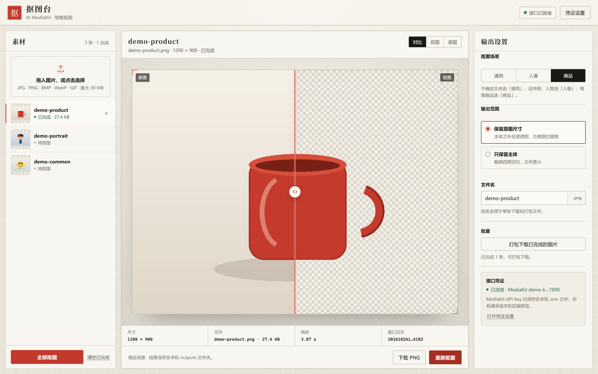
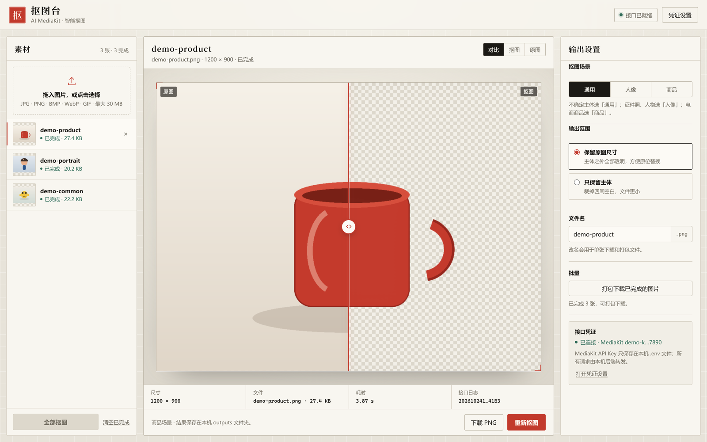
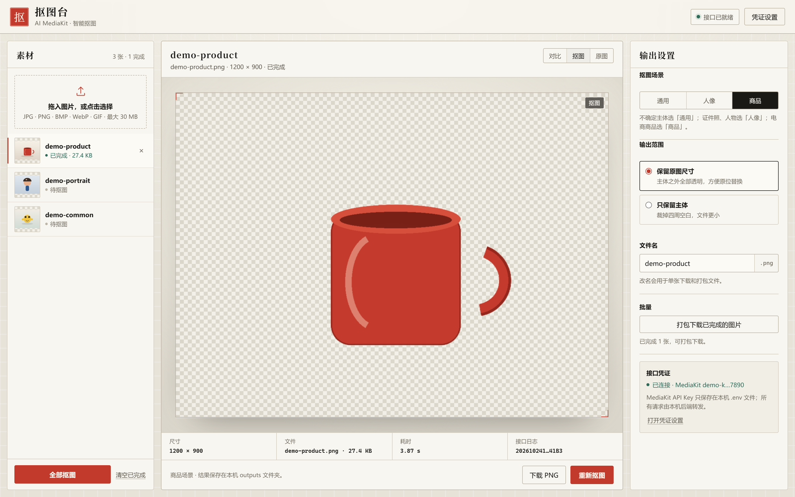
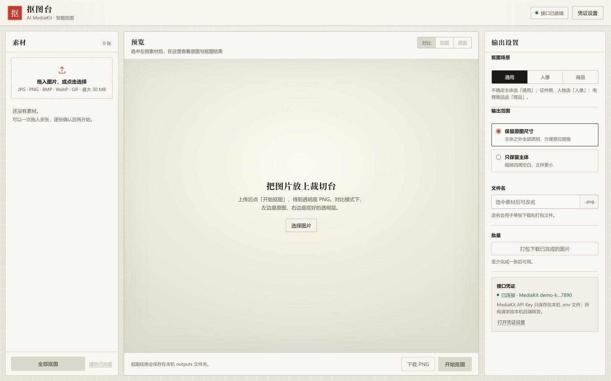
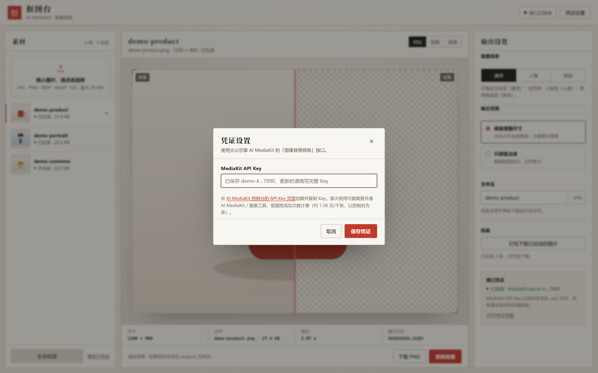
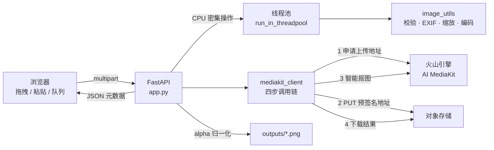
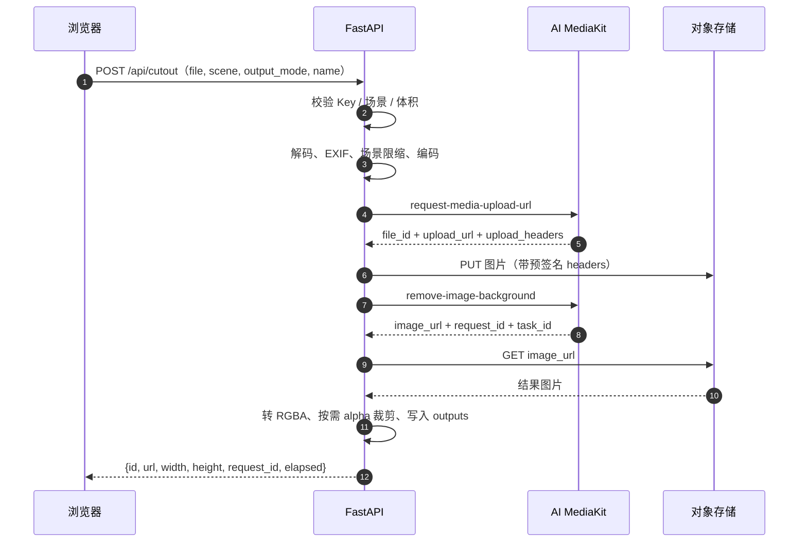

<div align="center">

<h1>✂️ Cutout Studio · 抠图台</h1>
<h3>本地优先的 AI 抠图工作台：批量、可控、可追溯。</h3>
<p><strong>A local-first AI background-removal workbench powered by Volcengine AI MediaKit.</strong></p>
<p>拖入图片，得到真正的 alpha 通道透明 PNG；凭证、原图和结果都留在你自己的机器上。</p>

<p>


<a href="https://github.com/jmlistening/ai-cutout-studio/actions/workflows/ci.yml"></a>
</p>

</div>

---

**[项目概览](#-项目概览)** · **[功能一览](#-功能一览)** · **[系统架构](#-系统架构)** · **[工程难点](#-工程难点与解决方案)** · **[安全模型](#-安全与隐私模型)** · **[快速开始](#-快速开始)** · **[测试与 CI](#-测试与持续集成)** · **[工程设计](docs/ENGINEERING.md)** · **[更新记录](CHANGELOG.md)** · **[安全策略](SECURITY.md)**

> **English TL;DR** — Cutout Studio is a local-first web workbench for AI background removal, built with FastAPI and the Volcengine AI MediaKit `remove-image-background` API. It covers the full media pipeline: input validation and normalization, presigned uploads, synchronous segmentation, alpha-PNG post-processing, a serial batch queue, a comparison slider and ZIP export. The API key never reaches the browser; the server binds to `127.0.0.1`, rejects cross-origin writes and sanitizes every user-controlled filename. 52 pytest tests cover the HTTP API, image pipeline, upstream error mapping and the frontend/HTML contract. MIT licensed.

## ✨ 项目概览

豆包 App 里的「AI 抠图」是一个消费级功能，并没有单独的公开开发者 API。公开可调的抠图能力在**火山引擎 AI MediaKit**——本项目用的就是它的「图像背景移除（智能抠图）」接口，并把一次云端调用包装成一套完整的本地工作台：

**拖入图片 → 本地校验与归一化 → 预签名上传 → 同步抠图 → alpha PNG 后处理 → 预览 / 批量 / 打包下载**。

它解决的不是“能不能抠”，而是“批量处理时能不能放心用”：

- **真透明，不是近似图**：结果保留 alpha 通道，支持“保留原图尺寸”和“只保留主体”两种输出。
- **本地优先**：服务只监听 `127.0.0.1`；API Key 只写进本机 `.env`（或由进程环境变量提供），浏览器永远拿不到完整 Key。
- **面向真实批量**：最多 50 张队列、逐张串行处理、单张重试、完成后 ZIP 打包。
- **可解释的失败**：把上游的鉴权、未开通、欠费、限流、尺寸超限等错误映射成明确的中文提示，并保留 `request_id` / `task_id` 便于排查。
- **零构建前端**：原生 HTML/CSS/JS，无 npm、无框架、无 CDN 依赖，启动即用。
- **工程可验证**：pytest + GitHub Actions 多版本矩阵 + MIT License。

### 为什么不是“豆包 API”？

这是一个常见的误解。豆包 App 的抠图是产品内功能；开发者可调用的是火山引擎的媒体处理能力。AI MediaKit 的抠图接口按成功处理次数计费（官方计费页当前约 **1.38 元/千次**，即约 **0.00138 元/张**，以控制台账单为准），本项目在 README 和界面里都明确标注了这一点，不做“免费无限抠图”的暗示。

## 📸 界面截图

> 截图取自项目在 Windows 本地运行的真实界面。演示素材是**程序生成的合成图片**（`docs/images/demo-*.png`），凭证掩码为演示用假值（`demo-k…7890`），不包含任何个人照片或真实 Key。

<p align="center">
  
</p>

<p align="center"><sub>拖动中线对比原图与抠图结果；右侧可切换场景、输出范围、文件名和批量下载。</sub></p>

| 批量队列：3 张已完成 | 透明结果：棋盘格预览 |
| :---: | :---: |
|  |  |

<details>
<summary><b>展开查看：空状态与凭证设置</b></summary>

<br>

| 空状态 | 凭证设置（Key 已掩码） |
| :---: | :---: |
|  |  |

</details>

## 🚀 功能一览

| 功能模块 | 具体能力 | 工程处理 |
| --- | --- | --- |
| **素材导入** | 拖拽、点击选择、`Ctrl+V` 粘贴；JPG / PNG / BMP / WebP / GIF；单张 ≤ 30 MB；队列上限 50 张 | 前端先做类型、体积和数量校验，后端再次独立校验，不信任客户端 |
| **上传前归一化** | EXIF 方向校正、GIF 取首帧、透明通道识别、按场景限制缩放 | 长边/短边/总像素三重约束；LANCZOS 等比缩放；必要时迭代重压缩到 ≤ 28 MB |
| **智能抠图** | 通用 / 人像 / 商品三种场景；保留原图尺寸或只保留主体 | 四步调用链：申请上传地址 → 预签名 PUT → 同步抠图 → 下载结果 |
| **结果后处理** | 统一 RGBA PNG；按 alpha 边界裁掉透明边 | 通用场景的“只保留主体”由本地 `alpha.getbbox()` 兜底，不依赖上游参数 |
| **预览对比** | 原图 / 抠图 / 对比三视图；鼠标拖动 + 键盘方向键控制对比线 | 双层叠放 + `clip-path`，指针事件与键盘事件共用同一套位置状态 |
| **批量处理** | 全部抠图、逐张进度、失败单张重试、清空已完成 | 串行处理，降低上游限流风险；每张独立更新状态，不阻塞其他素材 |
| **文件命名** | 选中即可改名；单张下载与 ZIP 都用自定义名 | 过滤路径分隔符、控制字符、Unicode 方向控制符、Windows 保留名；长度截断到 80 |
| **导出** | 单张 PNG；ZIP 打包最多 100 张 / 500 MB | ZIP 内文件名大小写不敏感去重，冲突自动追加 `(2)` |
| **凭证管理** | 网页内保存 Key，无需重启；状态与掩码实时显示 | `.env.tmp` + `os.replace` 原子写入；保存后清除进程环境变量覆盖 |
| **本地安全** | 仅监听 `127.0.0.1`；拒绝跨站写请求；安全响应头 | Origin 校验 + 自定义请求头 + 文件 ID 正则 + `Content-Length` 上限 |

### 核心技术栈

| 层次 | 技术 | 承担职责 |
| --- | --- | --- |
| Web 服务 | **FastAPI + Uvicorn** | 本地 API、静态页面、异常处理、线程池调度 |
| 上游调用 | **httpx.AsyncClient** | 四步 MediaKit 链路、超时控制、错误分类 |
| 图像处理 | **Pillow** | 解码、EXIF、缩放、编码、alpha 裁剪 |
| 前端 | **原生 HTML / CSS / JavaScript** | 队列状态机、拖拽上传、对比滑块、ZIP 下载 |
| 测试 | **pytest + httpx.MockTransport** | 全链路 mock，不依赖真实 Key 与外网 |
| CI | **GitHub Actions** | Ubuntu / Windows × Python 3.10–3.13 矩阵 |

## 🧭 系统架构

项目刻意保持**单进程、无数据库、零构建**：图片是短生命周期产物，用文件系统保存即可；没有账号体系，也就不需要会话与迁移。



**一次抠图请求的完整时序：**



### 项目结构

```text
ai-cutout-studio/
├── app.py                      # FastAPI 应用、路由、中间件、异常映射
├── config.py                   # .env 解析、Key 掩码、原子保存
├── image_utils.py              # 输入校验、EXIF、缩放、编码、alpha 裁剪
├── mediakit_client.py          # MediaKit 四步调用与错误分类
├── static/
│   ├── index.html              # 工作台结构
│   ├── app.js                  # 队列状态机、上传、对比滑块、导出
│   └── style.css               # 纸张 / 裁切台视觉系统
├── tests/                      # 52 个 pytest 测试
│   ├── test_api.py             # HTTP 路由与安全边界
│   ├── test_mediakit.py        # MockTransport 全链路
│   ├── test_image_utils.py     # 图像归一化边界
│   ├── test_config.py          # .env 编码与优先级
│   └── test_frontend_static.py # 前端 / HTML 契约测试
├── docs/
│   ├── ENGINEERING.md          # 更完整的工程设计说明
│   └── images/                 # 真实运行截图 + 合成演示素材
├── .github/workflows/ci.yml    # 多平台 / 多版本测试
├── requirements.txt
├── requirements-dev.txt
├── 启动.bat                     # Windows 一键启动
├── CHANGELOG.md
├── SECURITY.md
└── LICENSE
```

## 🧠 工程难点与解决方案

以下内容只描述**当前代码已经实现并经过测试**的处理，不把规划包装成成果。

### 01 · 四步上传链路：为什么不能直接 POST 图片？

MediaKit 的抠图接口不接受直接上传的文件流，而是要求：

1. `POST /api/v1/tools-sync/request-media-upload-url` 申请预签名上传地址；
2. 按返回的 `upload_headers` 把图片 `PUT` 到对象存储；
3. `POST /api/v1/tools-sync/remove-image-background`，用 `file_id` 触发抠图；
4. 立即 `GET result.image_url` 下载结果（官方地址 24 小时有效）。

**处理方式：** `mediakit_client.py` 没有引入官方 SDK，而是用 `httpx.AsyncClient` 实现完整链路，原因是：

- 上传响应里的 `upload_headers` 可能是对象、数组或 `"Key: Value"` 字符串；这里做了三种形态的兼容解析。
- `file_id` 可能不带协议前缀；缺少时补成 `mediakit://...`。
- 上传对象存储时**不能**带 MediaKit 的 `Authorization`，只带预签名头；这个边界在测试里被显式断言。
- 每一步的超时、网络错误、HTTP 错误和业务错误都映射成不同的 `MediaKitError` code。

**边界：** 同步接口意味着单张处理时间受上游影响（本项目默认超时 180 秒）。没有做异步任务队列，因为本地单用户场景下，串行 + 明确进度比引入 Redis/Celery 更可靠。

### 02 · 上传前的图像归一化：让“能抠”变成“稳定能抠”

直接把原图丢给上游，会在真实素材上频繁踩边界。上传前管线按以下顺序处理：

| 阶段 | 处理 | 目的 |
| --- | --- | --- |
| 体积检查 | `> 30 MB` 直接拒绝 | 避免无意义的上传与内存占用 |
| 解码保护 | 头部像素数 `> 6000 万` 拒绝 | 防止压缩炸弹在 `load()` 时吃满内存 |
| 方向校正 | 读取 EXIF `Orientation` 并 `exif_transpose` | 手机竖拍图不会横着被抠 |
| 动图 | `is_animated` 时取第一帧 | 避免 GIF 多帧语义不明确 |
| 场景限缩 | 通用：长边 ≤ 10240、短边 ≤ 6000、≤ 40 MP；人像/商品：≤ 7680 × 4320 | 严格对齐上游限制 |
| 编码选择 | 有 alpha 用 PNG；不透明图用 JPEG q92；必要时降质量到 88/84/80/76 | 在清晰度和 28 MB 上传上限之间取平衡 |
| 兜底缩放 | 仍超限则按 0.85 迭代缩小 | 极端高熵图片也能收敛 |
| 快速通道 | 未旋转、未缩放、格式已知、≤ 28 MB 时原样发送 | 大多数图片零重编码，节省 CPU 和时间 |

**权衡：** 这是“尽量不改变原图”与“保证上游一定收得下”之间的折中。透明 PNG 始终保留 alpha；不透明图才允许转 JPEG。

### 03 · 结果后处理：alpha 通道才是抠图的“真值”

上游返回的图片格式并不总是 RGBA PNG。`normalize_result_image()` 统一转为 RGBA，并在“只保留主体”模式下用 alpha 通道的包围盒裁剪：

```python
bbox = img.getchannel("A").getbbox()
if bbox:
    img = img.crop(bbox)
```

一个容易忽略的细节：**通用场景不传 `need_crop_background`**。该参数只对人像/商品生效；通用场景传了可能触发参数校验问题，所以本项目对通用场景改为本地 alpha 裁剪兜底。这样既保持上游请求干净，又保证“只保留主体”的语义一致。

**边界：** 本地裁剪基于完全透明的像素边界，不做羽化或语义分割；对于半透明边缘，包围盒可能略大于视觉主体。

### 04 · 失败可解释：把上游错误翻译成用户能行动的信息

上游可能返回鉴权失败、服务未开通、欠费、限流、尺寸超限、超时等完全不同的错误。如果只把 HTTP 状态码透传给前端，用户无法判断该改 Key、去充值，还是换一张图。

`mediakit_client._error_from_payload()` 会同时检查 `error.code`、`error.message` 和 HTTP 状态码，做关键词分类；`app.py` 再把业务 code 映射为对外的 HTTP 状态：

| 业务 code | 对外 HTTP | 用户看到的意思 |
| --- | ---: | --- |
| `NOT_CONFIGURED` | 400 | 还没填 MediaKit API Key |
| `MEDIAKIT_AUTH` | 401 | Key 无效或没有权限 |
| `MEDIAKIT_PERMISSION` | 403 | 服务/图像工具未开通 |
| `MEDIAKIT_BILLING` | 402 | 余额或免费额度不足 |
| `MEDIAKIT_RATE_LIMIT` | 429 | 请求太频繁，稍后再试 |
| `MEDIAKIT_BAD_IMAGE` | 422 | 图片尺寸或体积超限 |
| `MEDIAKIT_TIMEOUT` | 504 | 上游超时 |
| 本地空白结果校验 | 502 | 上游返回全透明图片，结果不写入 `outputs/` |
| 其他上游错误 | 502 | 抠图服务返回错误 |

同时保留 `request_id` 与 `task_id`，在界面的“接口日志”里展示，方便对照火山引擎控制台排查。

### 05 · 本地应用也要有安全边界

“只在本机跑”不等于“没有攻击面”。浏览器里的任意网页都可能向 `127.0.0.1` 发请求；用户上传的文件名也可能进入 ZIP。本项目做了以下约束：

- **只绑定 `127.0.0.1`**：`uvicorn.run(..., host="127.0.0.1")`，不监听局域网。
- **拒绝跨站写操作**：`POST /api/*` 如果带 `Origin`，其 hostname 必须是 `127.0.0.1` / `localhost` / `::1`。
- **自定义请求头**：`/api/cutout` 要求 `X-Cutout-Client: 1`，提高跨站表单伪造的成本。
- **文件 ID 白名单**：结果文件只接受 32 位小写十六进制 ID，`/files/../../win.ini` 之类请求在正则层就被拒绝。
- **文件名清洗**：去掉路径分隔符、控制字符、Unicode 方向控制符；处理 Windows 保留名（`CON`、`PRN`、`COM1` 等）；截断到 80 字符。
- **ZIP 去重**：大小写不敏感比较，冲突时追加 `(2)`，避免覆盖。
- **解码保护**：先看头部像素数，再 `load()`，防止超大图占满内存。
- **响应头**：`X-Content-Type-Options: nosniff`、`Referrer-Policy: no-referrer`、`X-Frame-Options: DENY`。

更完整的威胁模型与报告方式见 [SECURITY.md](SECURITY.md)。

### 06 · 前端：没有框架，但有一个明确的状态机

`static/app.js` 用约 1,100 行原生 JavaScript 管理：

- 素材状态：`pending → processing → done / error`，失败项可单独重试；
- 批量模式：串行处理，按钮实时显示 `正在处理 n/N`，不会并发打爆上游；
- 对比滑块：Pointer Events + 键盘方向键共用同一套 `comparePos` 状态；
- Blob URL 生命周期：移除素材、清空队列、页面卸载时调用 `revokeObjectURL`，避免内存泄漏；
- 参数持久化：只把 `scene` / `scope` 存进 `localStorage`，不存图片、不存 Key。

**权衡：** 没有引入 React/Vue，是因为这个界面只有一个页面、一个队列和三种视图；零构建带来的启动速度和依赖可控性，比组件化收益更大。

## 🔒 安全与隐私模型

| 资产 / 威胁 | 处理方式 |
| --- | --- |
| MediaKit API Key | 只保存在本机 `.env`（也可用环境变量覆盖）；后端返回给浏览器的只有掩码（如 `demo-k…7890`） |
| 浏览器窃取 Key | 没有任何接口返回完整 Key；设置接口只接受写入，不回读 |
| 恶意网页跨站调用 | 仅监听 `127.0.0.1`；Origin 白名单；`X-Cutout-Client` 自定义头 |
| 路径穿越 | 结果 ID 必须是 32 位十六进制；ZIP 只允许已存在的输出文件 |
| 恶意文件名 | 过滤非法字符、控制字符、双向文本控制符；Windows 保留名加前缀 |
| 压缩炸弹 | 解码前检查像素数；Pillow `MAX_IMAGE_PIXELS` 双重保护 |
| 上游超大响应 | 结果下载上限 80 MB；ZIP 上限 500 MB / 100 张 |
| 截图 / 仓库泄漏 | README 截图使用合成演示图与假掩码；`.env` 被 `.gitignore` 排除 |

**明确不在威胁模型内：** 多用户部署、公网暴露、企业级权限审计、恶意本机用户。如果你要把服务放到局域网或公网，请在前面加认证与反向代理，并重新评估 CSRF、限流和日志策略。

## 🔌 API 接口

| 方法 | 路径 | 说明 |
| --- | --- | --- |
| `GET` | `/` | 工作台页面 |
| `GET` | `/api/health` | 健康检查，返回版本号 |
| `GET` | `/api/status` | 凭证状态、掩码 Key、端点、场景限制 |
| `POST` | `/api/settings` | 保存 MediaKit API Key（原子写入 `.env`） |
| `POST` | `/api/cutout` | 上传并抠图：`file`、`scene`、`output_mode`、`name` |
| `GET` | `/files/{id}` | 预览结果；`?download=1&name=...` 触发下载 |
| `POST` | `/api/zip` | 按 `[{id, name}]` 打包已完成结果 |

`POST /api/cutout` 成功时返回：

```json
{
  "id": "32 位十六进制结果 ID",
  "url": "/files/<id>",
  "name": "自定义文件名",
  "width": 1200,
  "height": 900,
  "size": 27392,
  "scene": "product",
  "mode": "original",
  "request_id": "上游请求 ID",
  "task_id": "上游任务 ID",
  "elapsed": 3.95,
  "input": {
    "width": 1200,
    "height": 900,
    "sent_width": 1200,
    "sent_height": 900,
    "resized": false,
    "transcoded": false
  }
}
```

## ⚡ 快速开始

> 需要 Python **3.10 或更高版本**。所有命令都在项目根目录执行。

**Windows · 一键启动（推荐）**

双击 `启动.bat`。首次运行会自动创建 `.venv`、安装依赖；之后直接启动。浏览器会自动打开 `http://127.0.0.1:8765`，端口被占用时自动在 8765–8794 之间寻找空闲端口。

**手动启动**

```bash
python -m venv .venv
# Windows
.venv\Scripts\python.exe -m pip install -r requirements.txt
.venv\Scripts\python.exe app.py

# macOS / Linux
./.venv/bin/python -m pip install -r requirements.txt
./.venv/bin/python app.py
```

**配置 Key**

1. 登录[火山引擎控制台](https://console.volcengine.com/)，搜索并开通 **AI MediaKit**；
2. 打开 [AI MediaKit API Key 页面](https://console.volcengine.com/imp/ai-mediakit/settings) 创建 Key；
3. 在页面右上角「凭证设置」粘贴保存，或复制 `.env.example` 为 `.env` 后填写：

```dotenv
MEDIAKIT_API_KEY=你的_AI_MediaKit_API_Key
MEDIAKIT_ENDPOINT=https://mediakit.cn-beijing.volces.com
```

> 注意：这里需要的是 **AI MediaKit API Key**，不是火山方舟 ARK Key，也不是 AK/SK。计费和开通状态以控制台为准。

**使用流程**

1. 拖入图片，或点击上传 / `Ctrl+V` 粘贴；
2. 选择场景（通用 / 人像 / 商品）和输出范围；
3. 点「开始抠图」或「全部抠图」；
4. 拖动中线对比原图与结果，切换「对比 / 抠图 / 原图」；
5. 「下载 PNG」导出单张，「打包下载已完成的图片」导出 ZIP。

结果同时保存在本机 `outputs/`；清空队列不会删除已经生成的文件。

### 配置项

| 环境变量 | 默认值 | 说明 |
| --- | --- | --- |
| `MEDIAKIT_API_KEY` | 空 | AI MediaKit API Key；环境变量优先于 `.env` |
| `MEDIAKIT_ENDPOINT` | `https://mediakit.cn-beijing.volces.com` | API 端点 |
| `MEDIAKIT_TIMEOUT` | `180` | 单次上游调用超时（秒），连接超时固定 20 秒 |
| `PORT` | `8765` | 起始端口；被占用时自动向后寻找 |

## ✅ 测试与持续集成

```bash
python -m pip install -r requirements-dev.txt
python -m pytest -q
```

当前 **52 个测试全部通过**（Python 3.12.5 本地验证），覆盖：

- **HTTP 层**：页面、状态、凭证保存、跨站拒绝、路径穿越、ZIP 去重、错误状态映射；
- **上游链路**：用 `httpx.MockTransport` 模拟申请上传地址 → PUT → 抠图 → 下载的完整四步，断言请求顺序、鉴权头和 body；
- **图像管线**：EXIF 旋转、GIF 首帧、透明/不透明编码、场景限缩、alpha 裁剪、空白结果拒绝、垃圾数据拒绝；
- **配置层**：UTF-8 BOM、GBK、环境变量覆盖、原子保存、Key 掩码；
- **前端契约**：`app.js` 引用的元素 ID 必须存在于 HTML、静态资源必须存在、三种视图必须齐全、前端文件不得含裸控制字符。

仓库附带 [`.github/workflows/ci.yml`](.github/workflows/ci.yml)，在 push 和 pull request 时对 **Ubuntu / Windows × Python 3.10–3.13** 运行测试。徽章以 GitHub Actions 的实际结果为准。

## 🧪 可复现的演示数据

`docs/images/demo-*.png` 是程序生成的合成素材（马克杯、人物剪影、几何玩偶），专门用于截图和本地试跑，不包含任何个人照片。你可以直接把它们拖进工作台复现 README 中的界面。

生成脚本没有提交到仓库——这些图片只作为静态演示资产，避免把一次性截图工具混入运行时依赖。

### 一次真实冒烟测试

2026-10-24 在 Windows 11 / Python 3.12.5 上，用这 3 张合成图各调用一次真实 MediaKit 接口（约 0.004 元）：

| 素材 | 场景 | 耗时 | 输出 |
| --- | --- | ---: | --- |
| `demo-product.png` | `product` | 3.87 s | 1200 × 900 · 27.4 KB |
| `demo-portrait.png` | `general` | 3.39 s | 1200 × 900 · 20.2 KB |
| `demo-common.png` | `general` | 3.55 s | 1200 × 900 · 22.2 KB |

> 这是单机、单次观测，不构成性能基准；延迟取决于网络、图片尺寸和上游排队情况。合成人物剪影使用 `general` 场景，真实人像素材应使用 `human` 场景。

## ⚠️ 已知边界与取舍

- **同步接口**：单张处理受上游延迟影响；没有异步任务队列、断点续传或后台队列。
- **单机单用户**：没有账号体系、并发隔离和配额管理；不适合直接暴露到公网。
- **结果只存在本机**：`outputs/` 是普通文件，不做加密、过期清理或数据库索引。
- **只支持浏览器可预览的格式**：界面接收 JPG / PNG / BMP / WebP / GIF；MediaKit 虽支持 TIFF / HEIC，但浏览器无法可靠预览，所以没有放进上传入口。
- **文件名清洗是有损的**：非法字符会被删除，而不是转义；极长名称会截断到 80 字符。
- **裁剪基于 alpha 包围盒**：不做羽化、不做语义主体检测；半透明边缘可能让包围盒略大。
- **成本与配额由上游决定**：计费、免费额度、限流策略以火山引擎控制台为准，本项目不做保证。
- **不做自动重试**：失败后由用户手动重试；每次重试都会重新调用上游，可能重复计费。这样做是为了避免在余额不足或参数错误时产生不可控的重复扣费。
- **空白结果会被拒绝**：上游返回全透明图片时以 502 失败返回，不写入 `outputs/`，避免把“识别失败”当成成功结果。

## 🗺️ Roadmap

- [ ] 可选的后台任务队列（适合大批量 / 多用户场景）
- [ ] 本地结果库：缩略图索引、按时间清理、失败重跑
- [ ] 更多上游适配器（保持同一套本地 API）
- [ ] 可选的 Docker 镜像与反向代理示例
- [ ] 前端可访问性与键盘操作补全

> Roadmap 是方向，不是承诺；当前版本只保证上面“已知边界”之前的已实现能力。

## 📄 License

本项目采用 [MIT License](LICENSE)。欢迎通过 Issue / Pull Request 提出改进建议。提交复现材料时请使用合成或已脱敏的图片，不要把真实 API Key、个人照片或上游返回的签名 URL 贴进 Issue。
